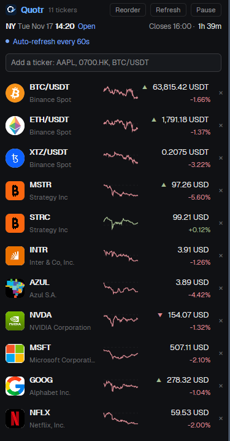

# Quotr

A stock and crypto watchlist docked beside your agents. Every ticker shows its logo, price, signed change and today's line, with a flash when the price moves. A clock line gives New York's date and time and the US regular session's next open or close with a countdown. Click a ticker for its dialog: 1D, 1W, 1M and 1Y charts with a hover readout, pre-market and after-hours for US stocks, and the logo's source. Based on [Pulse](https://github.com/fatwang2/Pulse) by fatwang2 (MIT).

## What you see

A panel 300px wide in the theme's `chrome` background with `foreground` text at 12.5px. The brand blue is `#6AB0FF` on dark themes and `#1066C6` on light ones (`settings().dark`). Top to bottom:

- **Header**, 12px padding: the logo (`icon.svg`, 18px, radius 5), `Quotr` (13.5px semibold, brand blue), `11 tickers` (11px `dim`, truncates), then small outlined buttons on the right: **Reorder** (with two or more tickers; reads **Done** while reordering), **Refresh** and **Pause** (22px high, 8px horizontal padding, radius 5, `border` outline, 11px `muted`; hover fills `hover`). Pause reads **Resume** while paused.
- **Market clock**, one 11.5px line: `NY` and the time semibold, New York's weekday and date between them in `muted` (`NY Tue Nov 17 14:20`); the session word (`Open` in `done`; `Pre-market` or `After-hours` in `working`; `Closed`, `Weekend`, `Holiday` or `Regular closed` in `dim`); right-aligned, the next event in `muted` and its countdown in `foreground` (`Closes 16:00 · 1h 39m`, `Opens Mon 09:30 · 2d 16h`, `Early close 13:00 · 1h 00m`). Without a usable schedule: the date and time, then `Loading schedule…` or `Market schedule unavailable`, and no countdown. When narrow, the event text truncates first; the countdown stays.
- **Status line**: a 6px dot and 11.5px text in one color: `Auto-refresh every 60s` (`done`), `Refreshing quotes…` (`working`, the dot pulsing 0.35 to 1 over 1.2s), `Auto-refresh paused` (`blocked`).
- **Add field**, 10px below: a 30px input, radius 6, `background` fill, `input` border (brand blue while focused), placeholder `Add a ticker: AAPL, 0700.HK, BTC/USDT`. Under it, one short line when there is something to say: an error (`ansi1`), the last edit's notice (`dim`), or a Yahoo rate-limit note (`blocked`).
- **Watchlist**, the rest of the height, scrolling. One row per ticker in saved order, 12px left padding, 7px vertical, `hover` background on hover:
  - a 31.5px logo tile (round for crypto, radius 7 for stocks): the cached logo over a monogram (the first letter in a `raised` tile), which shows alone when there is no logo. A logo with transparency sits on a white backdrop (a bare vector glyph inset, a raster icon full size);
  - the ticker (semibold, truncates) over the instrument name in 11px `dim`, with `As of Oct 31`, `Delay 15m` and `Updated 13:05` joined by ` · ` when they apply;
  - a 56×22 sparkline: observed 5-minute regular-session closes for stocks or 15-minute closes for pairs, 1.25px in `muted` within the top 15px, scaled vertically without the reference, with a minimum total span of 1% of the observed midpoint and 16% padding for larger ranges (0.03% noise spans 0.33px; a 20% swing about 9.48px). Time positions use the reported stock session or the quote's rolling 24h window; missing coverage stays blank. Below, a 2.5px daily-move rail at y=19 uses the headline's reference (stock previous regular close, crypto rolling 24h), zero at x=28 and ±50% at x=2/54, capped with an end stop. Nonzero moves have a 3px visibility minimum, not literal linear magnitude below that length; the cue is painted above the zero tick. The adjacent percentage gives exact magnitude. A 1px `muted` zero tick at x=28, y=16..21 crosses the `border` track. A stale/failed quote dims the box to 50%. Resting on it for 500ms opens a card (a `Popup` from `gpui-base` with the box as its trigger, anchored `top_right`, not the shell's one-line `tooltip`, which never wraps): 272px wide, `popover` surface with a `border` outline, radius 6, 11px text wrapped one paragraph per note, giving scales, reference, actual bar times/formatted price range and reference with supported currency/precision and independent quote freshness. Leaving the box or pressing it closes the card; the press still reaches the row, so the detail opens with no card over it. No reference rail when missing/inconsistent; no line without paired times/session or for out-of-session stock bars; crypto validates the entire paired/ordered/positive-finite cache before clipping only outside-window bars, retaining actual time positions and blank coverage; one bar is a dot. No inferred open or synthetic price point. In reorder mode, four 14px arrows instead (`⇈ ↑ ↓ ⇊`), dimmed where they can't move;
  - right-aligned in a 108px column: the price with its currency and under it the signed change (`ansi2` gains, `ansi1` losses, `dim` unknown). A 5px `working` dot pulses left of the price while that row refreshes. After a quote that moved, a 9px `▲` or `▼` stays until the next quote and a tint behind the price (32% opacity) fades over 1.6s;
  - a `dim` `×` that removes the ticker;
  - after a failed refresh, an 11px `blocked` line: `Stale · last updated 13:05 · <reason>`. Before any quote the price reads `Waiting…` (`Not fetched` while paused).
- **Footer**, a `border` line above, 10.5px: the sources in `dim` (`Yahoo Finance · Binance Spot · Stocks: regular session, exchange delays vary · Crypto: 24h change`), then one brand-blue link per logo source on screen with its count (`7 logos by AllInvestView ↗`, `4 logos by Elbstream ↗`).

**Detail dialog**, 440px wide, 18px padding, 14px between parts:

- a 49px logo, the ticker (16px semibold) over its name (11.5px `dim`); a 22px outlined pill with a dot and the session (`Market open`, `Pre-market`, `After hours`, `Market closed`, `Trades 24h`); a `dim` `×`.
- the price at 26px semibold, the change at 13px in its color, and what the change is (`day change vs prev close`, `24h change`).
- for a US stock with extended hours: the latest pre-market or after-hours price, its time and its change against the regular close; a note instead when that data is stale, missing or inconsistent.
- range tabs `1D 1W 1M 1Y` (22px, the selected one on `selected`).
- a 140px chart: the line at 2px over a 16% fill, the dashed previous close; on 1D with extended hours, shaded pre-market and after-hours bands with a legend. Hovering shows a vertical rule and the nearest real point's date, time, zone, price and session.
- stats: Open, High, Low, Prev close on 1D (a pair: 24h open, high, low); on other ranges the period's change, high, low and session count, with notes when a period is partial.
- `As of 15:04 · Delay 15m · Yahoo Finance · regular session` in 11px `dim`.
- the logo line: `Logo by AllInvestView ↗` (brand blue) and, when more than one source can show the ticker, a small outlined **Change** button.

**Band**: under 72px tall (docked top or bottom), one row: the 14px logo and `Quotr`, the clock shortened (`NY 14:20 Open closes 1h 39m`), `Paused` if paused, then each ticker as a 13px monogram, `AAPL 230.10 +1.23%`, 14px apart, clipped at the right edge.

## How it behaves

- Agent status plays no part.
- **First run**: with nothing saved, `AAPL`, `NVDA`, `^GSPC` and `BTC/USDT`. An emptied list stays empty. A watchlist and logo choices saved by Pulse (`pulse.watchlist.v1`, `pulse.logos.v1`) are copied once.
- **Adding and removing**: as in Pulse. Enter adds a Yahoo symbol or a Binance pair written `BASE/QUOTE`, upper-cased and checked; `×` removes at once.
- **Reorder**: the button swaps the sparklines for arrows (top, up, down, bottom); the order saves with the watchlist. Rows don't open dialogs while reordering.
- **Refreshing**: a round right after any edit, then every 60 seconds. Binance and Yahoo run side by side; Yahoo at most two requests at a time, starts at least 500ms apart. Last values stay on screen during a round. A Yahoo 429 holds stock requests for 60 seconds, doubling to 15 minutes; crypto continues.
- **Restart**: the last quotes are restored from `localStorage` and shown, marked `Updated HH:MM` when old, until fresh ones arrive.
- **Ticks**: a quote whose price differs from the previous one flashes green or red and keeps its arrow until the next quote.
- **Clock**: redraws alone once a minute, every second in the last minute before an open or close, on its own timer. The schedule is requested on start, on a New York date change and every 3 hours, one request at a time; failures retry after 30s, 2, 5, 15, then 30 minutes. A schedule older than 24 hours, or one whose next open has passed, shows as unavailable.
- **Logos**: at the start of each round, logos not yet cached download beside the quotes, one per symbol; a present logo is never fetched again automatically. **Refresh** re-downloads them one at a time, skipping any fetched within the last minute. A failed download keeps the previous file and waits 6 hours (55 seconds when there was no answer at all).
- **Change** (dialog): cycles the ticker through the logo sources that can show it, saves the choice for that ticker and downloads the new logo at once.
- **Links**: the attribution links open in the system's browser.
- **Dialog ranges**: 1W, 1M and 1Y load on first selection and are kept in memory (5 minutes and up); extended hours are requested only for stocks Yahoo says have them.
- **Copies** and **Pause / Resume**: as in Pulse; an edit in one copy shows in the others at once.
- **Commands**: `quotr.refresh` and `quotr.pause`, through `nextCommand()`. No keys bound by default.

## Built from

- **One mod**, `mods/quotr/`, no layout. `mod.json`: `{ "place": "right", "size": 300, "title": "Quotr" }`. As a pane: `pane.split {direction: "right", mod: "quotr"}`.
- `main.js`, with `charts.js`, `logoview.js` and `dialog.js` (methods joined to the one view class) and `context.js` (what they share on Herdr's side: storage keys, the logo cache's host, the history store, the link opener): the view (`gpui-kit` `View`, `div`, `image`, `PathBuilder`, `Background`, `window.paint_path`; `gpui-base` `h_flex`, `v_flex`, `InputState`, `Input`), panel or band by `on_size_change`. The dialog is the same mod: `openOverlay({ mod: "quotr", kind: "dialog", width: 440, props: { detail } })`.
- Modules with no Herdr imports, so `node --test` runs them, with Herdr's APIs passed in:
  - `quotes.js`, `watchlist.js`: Pulse's symbol rules, decoding, formatting and refresh loop, extended with per-point times, bounded concurrency, `move`, `restore` and per-row in-flight state.
  - `sparkline.js`: watchlist-only portable geometry and reference/session/freshness descriptions; `charts.js` draws it through `watchlistChart` with element-local percent-string coordinates converted from the 56×22 pixel model, leaving the shared detail chart unchanged.
  - `history.js` (1W / 1M / 1Y series and period stats), `readout.js` (nearest point, time-zone text), `extended.js` (pre-market and after-hours from Yahoo, session bands), `ticks.js` (which prices moved).
  - `logosource.js`: logo source adapters `{ id, name, attribution, lookup(symbol), imageUrl?(symbol, host) }`, tried in order. AllInvestView: its search API maps a symbol to a company domain, the image is `cdn.tickerlogos.com/<domain>`; a pair searches `BASE-USD`. Elbstream: `api.elbstream.com/logos/crypto/<BASE>` or `/symbol/<SYMBOL>`. Indices and FX/futures: no request. AllInvestView is the default for every ticker; Elbstream shows only for a ticker switched to it with Change. Small correction tables fix known mismatches.
  - `logocache.js`, `svgcheck.js`: the cache index (`.cache/logos/index.json`), file checks (HTTP 200, the bytes really PNG, JPEG or SVG, 300 KB cap), versioned file names, the draw style per file.
  - `marketclock.js`: New York time from the US daylight-saving rule (no `Intl` in Herdr's runtime), parsing and checking Nasdaq's answer, the session phase, countdown text, when to redraw and when to fetch.
  - `marketfeed.js`: loading that schedule: fetch first, curl second, each against a deadline, one request at a time, the last good schedule kept through failures.
  - `opener.js`: the opener per platform and URL checks.
- `clockview.js`: the clock as a retained nested view (`cx.new(MarketClock, { band })`, one per layout), its own `cx.spawn` loop with `cx.sleep`; it hands `marketfeed.js` Herdr's `fetch`, `exec` and a deadline from `cx.timer.after`.
- `assetlogo.js`: the monogram. `icon.svg`: Quotr's own icon.
- **Storage**: `shared("quotr.watchlist.v1")` (`{ version: 1, symbols, paused }`), `shared("quotr.logos.v1")` (`{ SYMBOL: source id }`), `shared("quotr.logos.rev")`; `localStorage` `quotr.quotes.v1` (last quotes) and `quotr.market.v1` (the schedule); logo files under `mods/quotr/.cache/logos/` (a hidden folder, so writing there doesn't reload the mod).
- **Network**, GETs with `User-Agent: Herdr-Quotr/1.0`:
  - `query1.finance.yahoo.com/v8/finance/chart/<symbol>`: quotes (`interval=5m&range=1d`), extended hours (`range=2d&includePrePost=true`), history;
  - `data-api.binance.vision/api/v3/ticker/24hr` and `/klines`;
  - `api.nasdaq.com/api/market-info`: `isBusinessDay`, `openRaw`, `closeRaw`, `pmOpenRaw`, `ahCloseRaw`, `nextTradeDate`;
  - `www.allinvestview.com/api/logo-search/?q=`, `cdn.tickerlogos.com/<domain>`, `api.elbstream.com/logos/...`.
- **Programs**: `curl` (logo downloads, https only, size and time capped; a `file://` copy inside the cache; the schedule when `fetch` fails), and one opener on a link click: `open` (macOS), `rundll32 url.dll,FileProtocolHandler` (Windows), `xdg-open` then `gio open` (Linux). Never through a shell.
- Herdr functions: `theme`, `settings`, `shared`, `setShared`, `nextCommand`, `props`, `openOverlay`, `closeOverlay`, `exec`, `appHome`, `checking`, `window` (for `platform`), `fs/promises` inside the mod's `.cache/`.

## Watch out

- The mod reaches the network (Yahoo Finance, Binance, Nasdaq, AllInvestView and its CDN, Elbstream), runs `curl` and a URL opener, and writes logo files inside its own `.cache/` folder.
- Check each source's terms before relying on it. Both logo sources ask for a visible attribution link wherever their logos show; keep the footer and dialog links, and store logos unmodified.
- Yahoo's chart endpoint and Nasdaq's market-info are unofficial. Check Nasdaq's answer strictly and never show a countdown from a schedule that is missing, old or used up. The next day's open is taken as 09:30 ET.
- `herdr-app check` blocks network access, so it can't show whether a request works; a request can also hang. Race requests against `cx.timer.after`, not `cx.sleep`, and cap how long "loading" can show.
- `herdr-app check` also has no window: `window()` returns null there, so fall back to `process.platform`.
- Herdr's `image()` takes local paths only, and `fs.writeFile` wrote empty files for binary data: download with `curl -o`, then check the bytes before showing a file.
- Saving any non-hidden file in the mod folder reloads the mod and clears its memory; keep runtime files in a hidden folder.
- On Linux `open` can be an unrelated program: choose the opener by platform, don't fall through from `open`.
- No `Intl` or time-zone data in Herdr's QuickJS: format numbers, dates and New York time by hand.
- `window` in a view is GPUI's drawing global; import Herdr's `window()` under another name.
- A nested view entity can be mounted once per render: the panel and the band each need their own clock.
- Each shown copy runs its own refresh loop. One copy is the intended setup.
- The clock describes US market sessions only, not every ticker's own exchange.

## Done when

- `herdr-app check mods/quotr` passes and `npm test` in the repository passes.
- A fresh install shows `AAPL`, `NVDA`, `^GSPC` and `BTC/USDT` with prices, sparklines and logos within a few seconds.
- The clock line shows New York's date and time and, within seconds, the session and a countdown; with the network off it shows the time and `Market schedule unavailable`.
- Clicking a stock opens its dialog; `1W`, `1M` and `1Y` load; hovering the chart shows a point's time and price.
- **Change** in a dialog switches the logo's source and the panel's footer counts follow.
- Reorder moves a row and the order survives a restart; so do the watchlist, the paused state and logo choices.
- Clicking an attribution link opens the browser on Windows, macOS and Linux.
- Resizing the block below 72px shows the one-line band.
