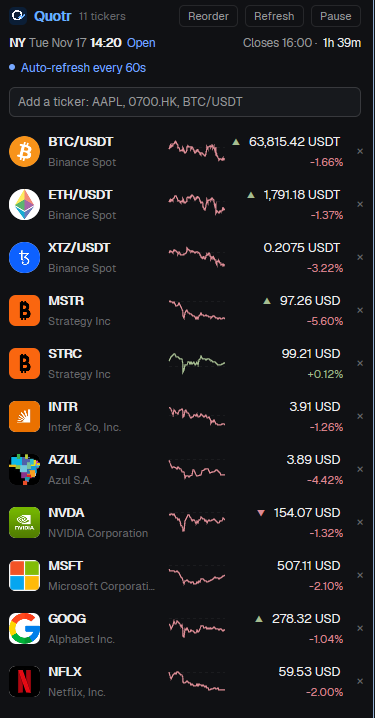

# Herdr Quotr

A stock and crypto watchlist panel for [Herdr](https://herdr.dev): live quotes with logos and
sparklines, price-tick flashes, and a detail dialog with history, hover readouts and pre/post-market
data for US stocks.

## Install

Open an agent in Herdr and ask it:

```text
Read ~/.config/herdr-app/AGENTS.md, then add this mod: https://github.com/crx-lc/herdr-mods/tree/main/quotr
```

The agent reads the mod's files, tells you what it reaches (see [Data sources and limits](#data-sources-and-limits))
and installs it without touching your other mods. To install by hand, see
[Installing and updating](#installing-and-updating).

## Preview



An example watchlist from the running mod. Prices and market status are a snapshot, not live data.
The screenshot is illustrative; it does not set the default watchlist.

## Based on Pulse

> **Quotr is based on [Pulse](https://github.com/fatwang2/Pulse) by [fatwang2](https://github.com/fatwang2).**
> It started as a copy of Pulse's Herdr mod,
> [`herdr/pulse`](https://github.com/fatwang2/Pulse/tree/main/herdr/pulse), at commit
> [`99f70b2c`](https://github.com/fatwang2/Pulse/tree/99f70b2c066c6f03657639bf44bf3cecd6e1bb43/herdr/pulse).

Pulse is MIT-licensed. Its copyright notice and license are kept in
[`LICENSE-PULSE.txt`](LICENSE-PULSE.txt) because parts of its code remain, mainly in the view files
(`main.js`, `charts.js`, `dialog.js`), `quotes.js` and `watchlist.js`. Quotr's own changes are under this repository's MIT license.
Not taken from Pulse: its name, its icon (Quotr has its own `icon.svg`) and its "Pulse for Mac"
promotion, which was removed.

## What Quotr changes

Compared with Pulse at `99f70b2c`:

**Detail dialog**
- 1D · 1W · 1M · 1Y ranges (`history.js`): period change from the first to the last point, period
  high and low, trading-session count, and notes when a period is partial or ends early.
- Hover readout on every chart (`readout.js`): the nearest real point's date, time and timezone (the
  exchange's own offsets from Yahoo; UTC for Binance), price and session.
- Pre-market and after-hours for US stocks (`extended.js`): latest extended price, its time and change
  against the regular close, shaded sessions on the 1D chart, and clear notes when data is stale,
  missing or inconsistent. Markets without extended data are labeled as such.
- A logo line, "Logo by … ↗ · Change": the source's attribution link, and a button that cycles the
  ticker through the logo sources that can show it.

**Panel and refresh**
- A New York market clock under the title (`marketclock.js`, `clockview.js`): New York time, the
  US regular session's state (Open, Pre-market, After-hours, Closed, Weekend, Holiday) and its next
  open or close with a live countdown ("NY Tue Nov 17 15:42 · Open · Closes 16:00 · 18m"), early closes included.
  It runs on its own timer, apart from the quote refresh. Without a current schedule it shows the time
  and "Market schedule unavailable", never a guessed countdown. The one-line band shows it shortened.
- Quotes refresh every 60 seconds while unpaused. The market clock keeps running independently.
- Last values stay visible during a refresh, with a small updating dot per row; quotes are restored
  from local storage after a reload or restart; failures show "Stale · last updated HH:MM".
- Price ticks: a short green/red flash and a ▲/▼ since the previous quote (`ticks.js`).
- Faster refresh: Binance and Yahoo side by side; Yahoo at most two requests at a time, starts 500 ms
  apart (Pulse: one at a time, 1 s apart), with Pulse's rate-limit backoff kept.
- Reorder mode (top / up / down / bottom), saved with the watchlist.
- Asset logos at the start of each row, with a monogram fallback.

**Logos** (`logosource.js`, `logocache.js`)
- Two sources: AllInvestView Ticker Logos is the default for every ticker; Elbstream is the
  alternative, chosen per ticker with **Change** in its dialog. There is no automatic failover: a
  failed download or an empty search result leaves the monogram until you switch the source.
- Automatic rules, no per-ticker setup: stocks by their exact Yahoo symbol, crypto pairs by base asset;
  indices and FX/futures get a monogram and no request. A corrections table handles known mismatches.
- Downloaded once into the mod's `.cache/` (Herdr's `image()` takes local files only), checked before
  use and reused during automatic quote refreshes. Manual Refresh queues re-downloads one at a time,
  skipping logos fetched within the last minute; quotes do not wait for them. A failed download keeps
  the previous good file when available. Transparent logos get a white backdrop.
- The footer credits each source with a count ("11 logos by AllInvestView ↗").

**Other**
- External links open on macOS (`open`), Windows (the system URL handler) and Linux (`xdg-open`,
  then `gio open`), chosen by platform, without a shell and only for https URLs (`opener.js`). If no
  opener works, the link simply doesn't open.
- Watchlist and logo choices saved under `quotr.*` keys; Pulse's saved watchlist is copied over once.

## Installing and updating

With an agent: the prompt under [Install](#install); ask the same again to update. From a clone of this repository: `node scripts/sync.mjs install quotr` (see the [root README](../../../README.md)),
or copy this folder to `~/.config/herdr-app/mods/quotr/`. Then
`herdr-app check ~/.config/herdr-app/mods/quotr` and open it as a panel:
`herdr-app do pane.split '{"direction":"right","mod":"quotr"}'`.

## Configuration

- **First launch:** without saved Quotr or Pulse state, the starter list is AAPL, NVDA, ^GSPC and
  BTC/USDT. A deliberately saved empty list stays empty. Existing Pulse watchlist and logo preferences
  are migrated once when the corresponding Quotr state is absent.
- **Watchlist:** add tickers in the panel (Yahoo symbols such as `AAPL`, `PETR4.SA`, `0700.HK`, or
  Binance pairs such as `BTC/USDT`); remove with ×; Reorder; Pause.
- **Logo source per ticker:** open the asset's detail dialog and click **Change** to cycle through its
  eligible sources. The choice is saved per ticker and shared by panels using the same Herdr state.
  No choice means Auto. The current button cycles sources, not arbitrary image URLs or an Auto/None
  menu. Defaults and corrections live in logosource.js.
- **Storage:** watchlist and logo choices use persisted Herdr shared state (quotr.watchlist.v1,
  quotr.logos.v1); quote snapshots and the market schedule use localStorage. Downloaded logos live
  in the mod's excluded .cache/ directory. Installing the source does not replace that saved state.
- **Keys:** `quotr.refresh` and `quotr.pause` can be bound in Herdr's `keys.json`.

## Panel sizing (provisional)

These are **provisional recommendations**, pending Windows narrow/default/wide previews,
installed-API inspection, splitter, small-window and existing-layout reload tests. The historical
preview above is unchanged and does not validate these proposals. Sizes are logical pixels at app
zoom 1; app zoom and OS scale change physical screenshot pixels. Record both during validation.

| Proposal | Logical px | Content budget and rationale |
|---|---:|---|
| Usable minimum | 280 | Row: 22 padding + 6 gap + 14 remove = 42; 238 remain for stacked symbol and values. Header/clock have 256 after 24 padding. |
| Suggested default | 340 | 298 for row content, 316 for header/clock. Ordinary tickers retain logo and 56×22 chart; long symbols/values get a full-width stacked row. Costs 60 more terminal pixels than 280. |
| Maximum useful content width | 440 | Ordinary wide row: 42 outer + 20 gaps + 56 chart + 108 values + 39.5 logo/gap = 265.5, leaving 174.5 for symbol/name. Costs 100 more terminal pixels than 340. |

These budgets specify component allocation, **not measured native glyph bounds or a no-overflow
pass**. The clock compacts first below 380 of its own header pixels (about 404 panel
pixels), dropping the inline date into its tooltip while retaining time, phase, event/countdown
or schedule-unavailable label. Row stages are independent: charts at 340+, logos at 300+,
stacking below 300 or when conservative character budgets reject the horizontal row. At 340,
42 outer + 20 gaps + 56 chart + 108 values + 39.5 logo/gap leave 74.5px for identity;
at 300 without a chart, 100.5px remain. The row uses an 8px-per-symbol-character budget;
a price with a first atom over 10 characters or total length over 12 also stacks. These are
provisional allocation heuristics, not native glyph measurements. Long stacked rows retain
logos/charts when their independent stages allow, at the cost of extra height.

Symbols may wrap in fixed chunks. Financial values break only at whitespace: signed numbers,
grouping, decimal precision, percentage suffixes and currency codes remain indivisible. Long
values get the full row allocation (238/298/398px at the proposals), rather than a 108px column.
The update dot and arrow are separately wrapping siblings. Metadata may truncate. Add, sources,
sessions, refresh/pause, removal, reorder and detail actions stay; financial formatting is unchanged.

Below 280, symbols use shorter chunks and controls wrap; financial atoms remain whole. There
is no forced content minimum. An atom wider than the available row can still overflow at tiny
widths; no native fit is claimed. At heights 72–359px the whole normal panel scrolls vertically.
The established height-only band rule remains: any block under 72px uses the historical one-line
quotes, clipped after those that fit, including top/bottom blocks 300–599px wide. This band has
its established shortened clock/quotes rather than normal-panel editing controls. At exactly
72px the normal scrolling panel resumes; a shortened panel test must use at least that height.
Above 440 the content stays at a soft 440px cap, aligned to the starting edge. **This does not bound
the host pane or recover terminal space**; the user must move the splitter to reclaim it.

Host controls audited against the saved official manual/source at Herdr app commit
[`317e673f`](https://github.com/herdrdev/herdr-app/tree/317e673f1f1568b876cbaa0b41dabeb9153ecbea):

- `mod.json` `place`/`size` requests **first-time layout docking**, documented under
  [Mods](https://github.com/herdrdev/herdr-app/blob/317e673f1f1568b876cbaa0b41dabeb9153ecbea/defaults/AGENTS.md#mods-modsname).
  This candidate requests 340 only there. Once seen, the layout decides. The saved source skips automatic docking on shipped layouts; it is only a request for an eligible
  new placement in a personal layout. This is not a guaranteed
  initial width for `pane.split`, and it never reapplies a default to an existing user layout.
- `pane.resize {direction, pane?, px?}` moves a tab pane border by a delta like a drag; it is not
  an absolute width setter or a min/max policy. No per-mod tab-split drag bounds are established
  by this audit. Quotr makes no resize calls and adds no unsupported manifest keys.
- Layout nodes document `size: {px}` / `{weight}`, `min`, `max`, and row/column `resizable`;
  `layout.resize {id, px | weight}` targets that tree. These are layout-block controls, not
  proof of tab-pane bounds or an invitation to edit an owner's layout.
- The manual describes layout clicks in `layouts/.state/` surviving restarts, and mod panes
  saved with their tabs in the Core document. Installed persistence/restoration remains untested.
  Quotr never writes layout state or stores measured widths: load, reload and resize leave host
  layout ownership with Herdr and the user.
- Root `on_size_change` supplies logical `{width,height}` after layout. Equal rounded sizes and
  invalid/zero measurements do nothing; absent measurements start compact. Only event callbacks
  notify, and the measured root always fills its host, independently of the content cap.
- `openOverlay`'s 440px detail-dialog width sizes an overlay only. It establishes no pane bound.

**Installed Windows API audit: unverified.** The saved manual/types/source are historical evidence,
not the installed binary. Hard tab-pane bounds would require host support that has not been
established; the in-scope alternative is responsive content with the limitations above.

Before accepting numbers, use a disposable Windows App home/Core with neutral fixture data, never
the working home: record executable/version/types/source head, zoom/scale and root dimensions;
capture 280/340/440 in dark/light with an adjacent terminal; inspect intermediate and below-minimum
widths, long symbols, large/low prices, both signs, unknown/stale/error states, clock states and all
actions. Drag both directions, shrink the window, then reload/restart an existing resized fixture
layout and verify its width/order/watchlist stay intact. Also check detail dialogs, logo attribution,
reorder, bands at 300/500/599/600/900×48, and the 72px panel boundary. These checks and App check/typecheck have **NOT RUN** for this
candidate on this Linux host. Node render recordings and any external drawings are **MODELED NOT
GPUI**, never Windows acceptance evidence.

Before acceptance/merge, whichever Quotr PR (#32 or #33) merges second requires a developer's
semantic rebase/resolution and fresh independent review, CI and required native evidence at the
integrated head. Recheck actual chart calls/wiring, availability, row budgets, responsive behavior
and tests against the actual integrated 56×22 channel. Textual conflict resolution alone is
insufficient. This same-issue gate is pending; this PR does not combine the candidates.

## Data sources and limits

- **Quotes:** Yahoo Finance's chart endpoint (unofficial, may be rate-limited or unavailable in some
  regions; regular-session prices with exchange delays, plus extended hours for US stocks where Yahoo
  has them) and Binance Spot public market data (24-hour change).
- **Online logo sources:** [AllInvestView Ticker Logos](https://www.allinvestview.com/tools/ticker-logos/)
  and [Elbstream](https://elbstream.com/logos). These are the two online sources currently supported.
  Source adapters make it easy to add others without changing the panel. See the logo selection and per-ticker settings above.
- **Market clock scope:** the Nasdaq schedule represents US market sessions, not the trading hours of
  every symbol in the watchlist. Crypto trades around the clock and other exchanges have their own hours.
- **Market schedule:** Nasdaq's public market-info endpoint (undocumented, the one behind
  nasdaq.com's market status), refreshed on a New York date change and every 3 hours while the panel is
  open. Failed requests retry with backoff; the client can fall back from fetch to curl. Schedules older
  than 24 hours are not trusted. It gives each day's hours and the next trading date; the next day's
  open is taken as 09:30 ET. New York time follows the US daylight-saving rule in force since 2007
  (Herdr's runtime has no time-zone data). "Regular closed" means only the regular session is known
  closed; the official holiday calendar is at [nasdaqtrader.com](https://www.nasdaqtrader.com/trader.aspx?id=Calendar).
- Logos remain their owners' trademarks and are shown only to identify each asset. No price data is
  guaranteed accurate or real-time.

## Requirements and tests

Use Herdr with its mod API. curl must be available for logo downloads and the market-schedule
fallback. External links use the platform's opener (see above). Node.js is needed for this
repository's sync script and tests, not for running the installed mod.

From the repository root, run `npm test`.
From this mod's directory, run `node --test ".tests/*.test.mjs"`. Both need Node 22 or later.

Run `herdr-app check` on the installed copy for a render/load check. Automated tests do not guarantee
that the external quote, schedule or logo services are available.
