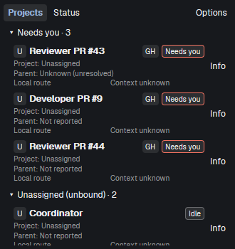

# Roster

A passive, explicitly opt-in Projects/Status sidebar for stock Herdr Desktop.
The current adapter keeps terminal identities provisional and project/context
associations unknown. Full release acceptance remains open.

[Production Status preview](preview-status.png). Both are real neutral 330×350
Windows slot crops at zoom 1, copied byte-for-byte from the R3 evidence.

## What you see

A theme-colored sidebar (`surface`/`foreground`, 12px base text, 5px padding,
3px gaps). A 26px horizontal toolbar holds Projects, Status and Options. Options
contains independent Machine/Context filters and selected-slot opt-in/undo controls
in a separately scrolling region with an explicit viewport height of min(52, n×24 + (n−1)×2)px, min_h(0), flex_none and no max_h. Unfiltered singleton dimensions
omit redundant selectors; active filters always retain a reset.

The remaining height is a scrolling row list: 24px group headers, non-shrinking
64px terminal rows. Each has an 18px title/badge line, independent 14px Project
and verified Parent lines spanning beneath badges, and a 14px machine/route and
execution-context line, plus 4px padding. Preserve depth indentation capped at
24px and one direct scroll child per instance. Keep Info and child-fold buttons
as siblings of terminal activation, with that same owner key and rowIndex.
Use truthful Unassigned, Not reported, Unknown (resolution), host unknown and
Context unknown fallbacks. State chips cap at 104px; each row line may ellipsize.
Done starts folded; global Needs you survives filters/folds. Contextual Child
needs you remains nonactionable. Provider badges describe work items/projects.

Disabled selections have a separate readable 16px reason above a 16px summary
and Details (D) affordance; enabled selections use 16px. A layout message uses
16px. Worst fixed normal-list budget is 148px, leaving about 170px at fixed
physical 350px/zoom1.1: plan two 64px rows, a 24px header and two 3px gaps (158px).
The R3 native report records actual fit at both zooms; arithmetic alone is not acceptance. Full contextual row
hover includes waiting, project, parent, provider, route/context and reason.

Explicit Details at opening replaces everything below the toolbar with one
captured, nonpersistent instance snapshot. Display a 24px Back (Esc)/title line,
18px field label, 18px global/field progress, active literal value and 24px
Previous/Next controls, with 4px gaps. Use fresh text, full available width,
whitespace_normal, 12px, line_height(1.25); no clipping/ellipsis/clamp on the value
or ancestors. Pages have at most 64 Unicode code points and three line breaks
(CRLF or lone CR/LF), preserving every UTF-16 source span, whitespace and terminal suffix.
Render only the active page, with no total-length cap or detail-scroll dependency.
Use separate name/project/parent/machine/context/state/waiting/provider/availability/
filter/diagnostic fields. Keep full waiting in expanded compact and hidden-child
modes. R3 reports tested wide-glyph, newline and long-token pages fit at both zooms, subject to the font limits below.
Production has no admitted authoritative waiting. Stock Desktop 0.1.16 UIA
exposes no mod labels; Narrator was not run, and the reader is no UIA pass.

## How it behaves

`place:none` makes installation inert. Explicitly show a copy only after authorized
isolated checks; installation instructions are not permission to activate it.
Rendering captures six stock getters once: terminals, machines, panes, spaces,
agents and focused. Only current snapshot observations appear; vanished rows and
superseded incarnations are omitted. No supplementary history is acquired.
Equal names, remote aliases, viewing machine and account/model do not prove identity.
Projects stay unbound and contexts unknown without Core-qualified configuration.

Projects/Status, filters and folds affect this copy. Click focuses it; Up/Down
select a visible control, Enter activates it; `focus` focuses the handle. Preserve
surviving cursor keys and choose a nearby position when a control disappears.
D on a row/Info/fold, or Enter/click on Info/Details, opens the reader.
Left/Up/Previous and Right/Down/Next page; Home/End jump; Esc/Back returns and
reveals the surviving originating control, or selects Projects if its exact
instance disappeared. Never rebind duplicate names. Enter in the reader uses
only reader callbacks. View/filter/fold and Options changes close it locally;
unhandled keys retain host behavior. Never bind global next/previous or call setAgentOrder. Production Open is disabled:
no independently bound Core identity, endpoint or uninterrupted remote epoch is
available. Injected tests may prove exact focus/peek plans; that is not a native
capability claim. Native terminal statuses, input, approvals and lifecycle stay native.

Explicit opt-in inspects one current Agents slot, preserves the effective tree,
saves a private restoration record, creates a separate working layout replacing
only that slot, then switches. Undo rereads its record after restart and restores
only the still-owned slot in the latest working tree. Refuse mismatches/concurrent
changes. Two-second UI deadlines do not cancel late native writes; expected-text
writes are not OS-wide CAS. Partial failures can leave files for inspection.

## Built from

One self-contained `mods/roster/`: `mod.json` has `place:none`, `focusable:true`;
`main.js` wires gpui-kit/gpui-base/Herdr to `view.js`. `desktop.js` exposes stock snapshots
and guarded layout I/O. `controller.js` connects `feed.js`, `local-reader.js`,
projection and action guards. Pure modules have no Herdr imports:
`normalize.js`, `identity.js`, `metadata.js`, `delegations.js`, `attention.js`,
`projection.js`, `navigation-rows.js`, `navigation.js`, `settings.js`, `icons.js`,
`detail.js` (presentation facts/reasons/lossless pages), and `layout.js`. Keep the actual reducer chain and independent evidence contracts;
see `mods/roster/MODULES.md` for data shapes.

Production supplies empty Core mappings, admissions, documents, routes, scopes and
correlations. Thus it acquires zero delegation files, performs zero terminal
actions, and reads no private settings/images. Local-reader admission requires
independent process/Core/continuity proof; only local text reads are allowed with
bounded candidates/bytes, two native slots and `cx.timer.after` deadlines. Never
enable native remote readTextFile: it can start a Core at the inspected revision.
No experimental acquisition reader, runtime hc probe or network request is shipped.

Only explicit layout controls read/write layouts and private App data restoration
records. Never bundle those records or personal assets. No third-party assets,
packages or network sources are added. Source pins in the installed README are
reference contracts, not installed Desktop evidence. Repository-only scripts and
`.tests` do not ship. `node scripts/roster-package.mjs` lists exactly the 21 files
that would ship, validates eager import closure, and performs no install/sync.

## Watch out

The [external Windows R3 report](https://github.com/crx-lc/herdr-mods/issues/21#issuecomment-7083288510) validated runtime source `929d85903dc0b32e2fe05b4b98e8d258c63b7f74` on Windows 11 Pro 10.0.26300, stock Desktop 0.1.16, hc 0.1.21, Node 26.13.1 and tsc 7.0.2. At 100% OS scale the slot was 330×350 physical pixels: zoom 1 uses 330×350 logical, zoom 1.1 uses 300×318 logical. The report records 53 pass, 1 fail, 4 not verifiable, and isolation 3/3. Toolbar return, reader paging, machine/context fit, Options, scrolling and selected-slot opt-in/undo/restart passed the described presentation checks at that source head. Repo tests were 416 total, 415 pass and one optional skip; package inventory had 21 files, typecheck and native check passed, 16 sample states passed and 22 deliberate breaks were detected. This packaging changes only documentation and preview images; runtime files remain byte-identical to that source. Windows did not run on the later packaging commit. Raw private logs were not independently audited here.

**Remaining criteria:** stock Windows UIA exposes no Roster labels; Narrator was not run. Production exact Open/Peek (local, remote and pane-less), authoritative Waiting, private project images and finished rows were not verifiable. Injected route and waiting positives are UI test fixtures, not production capability proof. Issue #21 remains open; no full release acceptance or scope waiver is claimed. Stock Desktop 0.1.16 overlay shows only toolbar and Options; selected Agents-slot opt-in is the tested path.

The native tooltip can clip at the window edge; D or pointer Info/Details supplies the complete in-panel reading path. Tested common Unicode and page boundaries preserved text without clipping. Stock fonts displayed regional-indicator components rather than flags, tag sequences as a black flag, and ZWJ sequences as components; lone CR was invisible. These rendering limits are distinct from text loss. The pagination is not full UAX #29.

Stock snapshots cannot prove permanent Core/remote-epoch binding. Unknown must
remain unknown; do not enable actions, authoritative waiting or private images to
make a demonstration look complete. Host fixtures exercise stronger contracts;
production must not adopt invented fixture proof. Waiting parents count zero
workers; three genuine working delegates count three under admitted contracts.

The original layout file and shipped Agents source are not rewritten by opt-in;
the external Windows report records preservation/restart/undo passes. Keep Quotr,
other slots/settings and private data intact. Timed-out writes may settle later:
reread before retry. Do not promise automatic cleanup or whole-tree rollback.

Node tests and Windows Node CI cannot prove QuickJS/GPUI layout, focus, tooltip,
accessibility or native image decoding. Herdr check alone cannot see later async
states or actual layout; sample-state checks need an effective deliberate break.
Do not claim any App/typecheck/Windows/visual run without its actual evidence.

## Done when

Repository packaging is reviewable when `npm test`, optional offline pinned
contract parity when available, and the read-only inventory pass, with negative
controls rejecting missing/forbidden files, links and escaping references. Record
actual commands/counts separately from planned workstation checks.

The R3 report above is tied to the exact runtime source, not a claim that a later packaging commit ran on Windows. Full acceptance remains open in [#21](https://github.com/crx-lc/herdr-mods/issues/21), [#11](https://github.com/crx-lc/herdr-mods/issues/11), [#10](https://github.com/crx-lc/herdr-mods/issues/10) and [#4](https://github.com/crx-lc/herdr-mods/issues/4). No live activation is authorized by this evidence.
